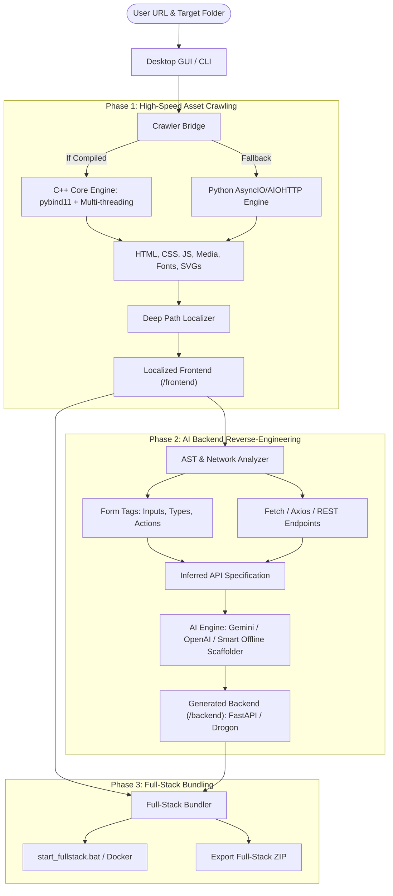

# 🌐 AI-Powered Full-Stack Website Cloner & Code Generator (Python + C++)

An enterprise-grade hybrid desktop system that scrapes 100% of a target website's frontend assets at hardware speed, localizes all asset paths for autonomous offline execution, and uses an AI reverse-engineering engine to automatically synthesize a matching, functional backend API (FastAPI / Drogon C++).

---

## 🏛️ System Architecture



---

## 📂 Project Structure

```text
ai-fullstack-cloner/
├── cpp_core/                  # High-performance C++ crawler core & path localizer
│   ├── CMakeLists.txt         # CMake build configuration for pybind11
│   ├── include/
│   │   ├── crawler.hpp        # Crawler class, thread pool, callbacks
│   │   └── path_localizer.hpp # Recursive link rewriting & endpoint detection
│   ├── src/
│   │   ├── crawler.cpp        # Worker loop, concurrent queue, I/O
│   │   ├── path_localizer.cpp # Regex link localizer (href, src, url)
│   │   └── bindings.cpp       # pybind11 module definition
│   └── README.md              # C++ compilation guide
├── python_engine/             # Python orchestration & AI pipeline
│   ├── crawler_bridge.py      # Dynamic switch: C++ Core <-> Async Python
│   ├── python_crawler.py      # Asyncio/aiohttp asset scraper & path rewriter
│   ├── ast_analyzer.py        # Static analysis of forms & fetch/axios calls
│   ├── ai_generator.py        # LLM integration (Gemini / OpenAI / Offline)
│   ├── project_templates.py   # FastAPI & Drogon project code generators
│   └── bundler.py             # Packaging, start scripts, and ZIP compression
├── ui/                        # Modern Desktop GUI
│   └── app_gui.py             # CustomTkinter dark-mode desktop interface
├── main.py                    # Unified entry point (GUI or CLI mode)
├── requirements.txt           # Python library dependencies
└── README.md                  # Comprehensive documentation
```

---

## 🚀 Quick Start

### 1. Requirements & Installation
Ensure you have Python 3.10+ installed:
```powershell
pip install -r requirements.txt
```

### 2. Launch the Modern Desktop GUI
Simply run:
```powershell
python main.py
```
From the GUI:
1. Enter your target website URL (e.g. `https://quotes.toscrape.com` or your web app).
2. Choose your destination directory.
3. Select your desired Backend Framework (`FastAPI (Python)` or `Drogon (C++)`).
4. Select your AI Engine (`Smart Offline Scaffolder`, `Google Gemini`, or `OpenAI`).
5. Click **🚀 Start Scraping & Code Generation**.
6. When complete, click **📦 Export Full-Stack ZIP** or **📂 Open Output Folder**.

---

## 💻 Headless CLI Mode

For automated pipelines, testing, or server environments:
```powershell
python main.py --cli --url https://quotes.toscrape.com --output ./cloned_projects/quotes --framework fastapi --export-zip
```

### CLI Parameters:
- `--cli`: Runs without launching the GUI.
- `--url`: Target URL to clone.
- `--output` (`-o`): Output directory for the bundled project.
- `--framework`: `fastapi` (default) or `drogon`.
- `--provider`: `offline` (default), `gemini`, or `openai`.
- `--api-key`: API key for Gemini or OpenAI (optional).
- `--depth`: Crawl depth (default `2`).
- `--threads`: Concurrent network threads (default `12`).
- `--export-zip`: Automatically produces a deployable `.zip` archive.

---

## ⚡ How the Generated Full-Stack App Works

The generator creates a completely independent project:
```text
cloned_project/
├── frontend/             # 100% of the downloaded CSS, JS, images, and HTML (fully offline)
├── backend/              # Synthesized FastAPI (or Drogon) server
│   ├── main.py           # API routes + mounts frontend at root '/'
│   ├── models.py         # Pydantic schemas reverse-engineered from forms
│   ├── database.py       # Simulated JSON data persistence
│   ├── requirements.txt
│   └── run_server.py
├── start_fullstack.bat   # Windows one-click start script
├── start_fullstack.sh    # Linux/macOS start script
├── Dockerfile            # Container deployment
└── docker-compose.yml
```

### Running the Cloned Project
On Windows:
```cmd
cd cloned_project
start_fullstack.bat
```
Or manually:
```bash
cd cloned_project/backend
pip install -r requirements.txt
python run_server.py
```
Open **`http://localhost:8000`** in your browser:
- The cloned site loads **instantly and offline** from the local filesystem.
- When you fill out forms or trigger actions, requests hit the auto-generated backend API endpoints at `/api/...`.
- Interactive Swagger documentation is available at **`http://localhost:8000/docs`**.

---

## 🛠️ Compiling the C++ Core (Optional)

The application includes a dual-engine architecture:
- If `cpp_crawler` is compiled via `pybind11`, it runs the C++ worker pool.
- If running without a C++ compiler toolchain, it transparently uses the asynchronous `aiohttp` Python engine with 100% feature parity.

To compile the C++ engine with Visual Studio / MSVC on Windows:
```powershell
cd cpp_core
mkdir build
cd build
cmake .. -A x64 -Dpybind11_DIR="$(python -c 'import pybind11; print(pybind11.get_cmake_dir())')"
cmake --build . --config Release
copy Release\cpp_crawler.pyd ..\..\
```

